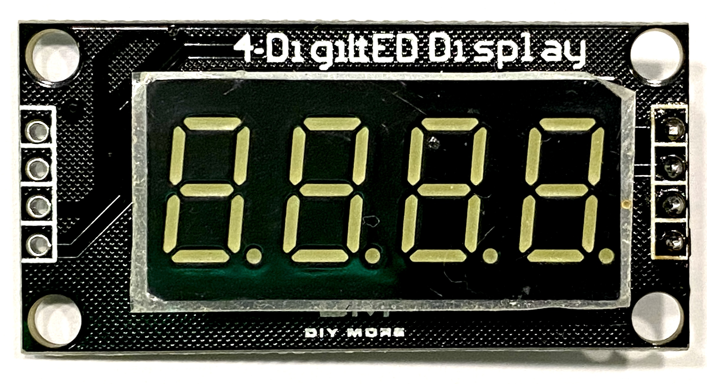
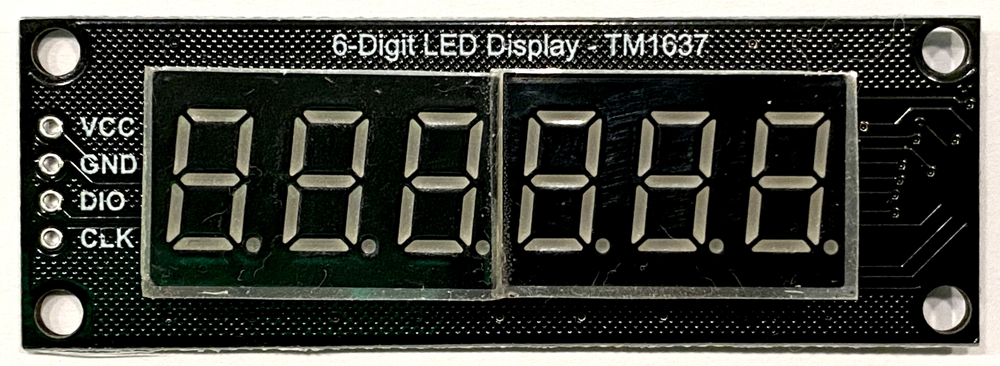
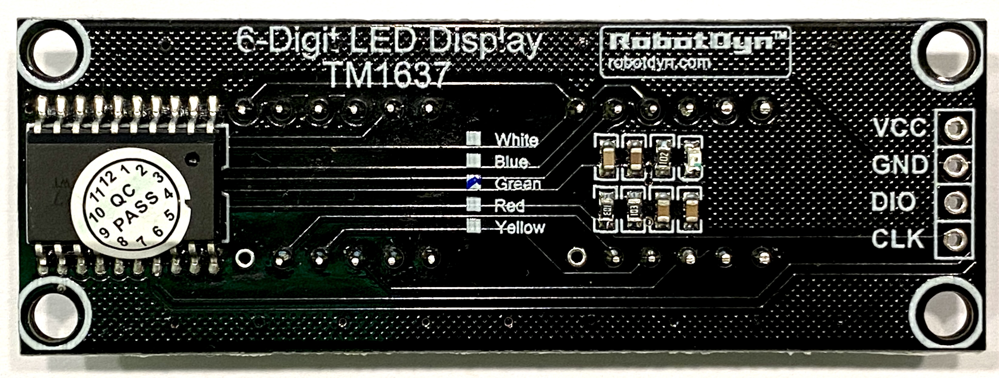

# ESP TM1637 #

ESP-IDF library for 7-segment LED displays with the TM1637 chip

**Version 1.1.0** (in development, not tested on hardware yet) — see [Changelog.md](Changelog.md).

## Description

This library supports displays with **1 to 6 digits** (typically 3, 4 or 6) with decimal points.
It builds with ESP-IDF 4.3+ / 5.x for all ESP32 chips (checked with ESP-IDF 5.5.1 for ESP32,
ESP32-S3 and ESP32-C3). Not yet tested, but it should work with ESP8266_RTOS_SDK and under
esp-open-rtos as well.

### Wiring

- SEG1..SEG8 → segments A..G and DP; GRID1 → leftmost digit (GRID2, GRID3, ... to the right).
  6-digit modules use the usual 2-1-0-5-4-3 wiring, handled by the library.
- The display must be **common anode**.
- CLK and DIO need **pull-up resistors to the MCU logic level** (e.g. 10 kΩ to 3.3 V). The TM1637
  itself may run from 5 V; it only pulls DIO low, so the MCU pins never see 5 V. On ESP-IDF the
  lines are driven **open-drain** (the internal pull-ups are enabled as a weak addition).
- Pull-ups to 5 V must not be used with ESP32 chips (pins are not 5 V tolerant). Ready-made
  modules often have their pull-ups to the module VCC — move them to 3.3 V when VCC is 5 V.

### Robustness

- Every byte waits for the TM1637 ACK for at most `CONFIG_TM1637_ACK_TIMEOUT_US` (100 µs).
  Without an ACK the display is marked offline (`tm1637_is_online()` returns false), the write
  is abandoned and the next attempt is made after `CONFIG_TM1637_RETRY_MS` (5 s) — a missing or
  broken display never blocks the application.
- A display object must be used from **one task** only (no locking inside).

### Configuration (`menuconfig → TM1637 display`)

| Option | Default | |
|---|---|---|
| `CONFIG_TM1637_BIT_DELAY_US` | 3 | Half bit time; also `tm1637_set_delay_us()` at run time |
| `CONFIG_TM1637_ACK_TIMEOUT_US` | 100 | ACK wait per byte |
| `CONFIG_TM1637_RETRY_MS` | 5000 | Retry interval of an offline display |







```c
tm1637_led_t *display = tm1637_init(CLK_GPIO, DIO_GPIO, 3);   // NULL when out of memory
tm1637_set_brightness(display, 4);
tm1637_print_temp(display, 852);                             // " 85.2" on 3 digits
uint8_t seg[] = {0x77, 0x38, 0x00};
tm1637_print_symbols(display, seg, 3);
tm1637_delete(display);
```

It takes care automatically for float numbers and displays positive or negative numbers with maximum possible signs after the decimal point.

The usage is simple as importing this raw in the main application:

```c
tm1637_print_float(Display, FloatValue);
```


Print string of characters based on ASCII code is possible by using the following example:

```c
tm1637_print_string(Display, "Auto");
```


Another useful function is for printing temperature values.

```c
tm1637_print_temp(Display, IntValue);
```
For example a temperature value multiplied by 10 (e.g. 242) is displayed as
(3 digits: `24.2`, `-9.9`, `150`, `-12`; 4 digits: `24.2º`; 6 digits: `-24.2ºC`):


It also supports functions for testing segments, cleaning display, printing raw data etc.

## References and Credit

This library is based on:
*  https://www.mcielectronics.cl/website_MCI/static/documents/Datasheet_TM1637.pdf
*  https://github.com/petrows/esp-32-tm1637
*  https://github.com/jasonacox/TM1637TinyDisplay
*  https://github.com/avishorp/TM1637

You can find such modules at:
*  https://a.aliexpress.com/_vdwpwd
*  https://a.aliexpress.com/_v1qdS5
